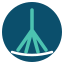

{ .hero-logo }

# {{ project.acronym }}

**{{ project.title }}**

This project strengthens **DELTA-Hub**, the River Delta Science, Education, and Modeling Hub
hosted by the University of Bucharest, through scholarships, international mobilities, new
research equipment, and a scientific visualisation and outreach laboratory.

!!! info "Funding"
    This project is funded by **{{ project.funder }}** (Executive Agency for Higher Education,
    Research, Development and Innovation Funding) under
    **{{ project.programme }}**.

## Project at a glance

<dl class="id-card" markdown>
  <dt>Project title</dt><dd>{{ project.title }}</dd>
  <dt>Project number</dt><dd>{{ project.number }}</dd>
  <dt>Financing contract</dt><dd>{{ project.contract }}</dd>
  <dt>Call</dt><dd>{{ project.call }}</dd>
  <dt>Coordinator</dt><dd>{{ project.coordinator.name }} – {{ project.coordinator.unit }}</dd>
  <dt>Project director</dt><dd>{{ project.director.name }}</dd>
  <dt>Partners</dt><dd>Single-institution project (no consortium partners). Collaborators are listed on the <a href="project/#collaborators">Project</a> page.</dd>
  <dt>Duration</dt><dd>{{ project.duration }}</dd>
  <dt>State budget</dt><dd>{{ project.budget.state }}</dd>
  <dt>Co-financing</dt><dd>{{ project.budget.cofinancing }}</dd>
  <dt>Total value</dt><dd>{{ project.budget.total }}</dd>
</dl>

## Explore

- [**Project**](project.md) – objectives, activities, equipment, budget and expected results
- [**Team**](team.md) – project director and team members
- [**Reports**](reports.md) – stages, activities and results achieved
- [**Results & Impact**](results.md) – main results and their scientific and socio-economic impact
- [**Publications**](publications.md) – up-to-date list of publications
- [**Events**](events/index.md) – workshops, hackathons, IAB meetings and outreach
- [**Contact**](contact.md)
