<section class="hero" markdown>
UEFISCDI · Premiere Orizont Europa – Instituții

<h1 class="hero__title">Support</h1>

Strengthening <strong>DELTA-Hub</strong>, the River Delta Science, Education and
Modeling Hub of the University of Bucharest, through scholarships, international mobilities,
new research equipment and a scientific visualisation laboratory.

[Discover the project](project.md){ .md-button .md-button--primary }
[Explore 3D & VR models](vr.md){ .md-button }
</section>

  
1.64 Mlei state budget

  
3stages · 2025 – 2027

  
4research scholarships awarded

  
2visualisation labs · fixed &amp; mobile

## Project at a glance

<dl class="facts">
  
<dt>Project title</dt><dd>{{ project.title }}</dd>

  
<dt>Project number</dt><dd>{{ project.number }}</dd>

  
<dt>Financing contract</dt><dd>{{ project.contract }}</dd>

  
<dt>Funded by</dt><dd>{{ project.funder }} – {{ project.programme }}</dd>

  
<dt>Coordinator</dt><dd>{{ project.coordinator.name }} – {{ project.coordinator.unit }}</dd>

  
<dt>Project director</dt><dd>{{ project.director.name }}</dd>

  
<dt>Partners</dt><dd>Single-institution project. See <a href="project/#collaborators">collaborators</a>.</dd>

  
<dt>Duration</dt><dd>{{ project.duration }}</dd>

  
<dt>State budget</dt><dd>{{ project.budget.state }}</dd>

</dl>

## Explore

-   :material-information-outline:{ .lg } **[About the project](project.md)**

    Objectives, activities, equipment, budget and expected results.

-   :material-account-group-outline:{ .lg } **[Team](team.md)**

    Project director, researchers, scholarship holders and advisory board.

-   :material-file-chart-outline:{ .lg } **[Reports](reports.md)**

    Stages, activities and results achieved, with photos.

-   :material-trophy-outline:{ .lg } **[Results & Impact](results.md)**

    Main results and their scientific and socio-economic impact.

-   :material-book-open-variant-outline:{ .lg } **[Publications](publications.md)**

    Up-to-date list of articles, conference papers and datasets.

-   :material-virtual-reality:{ .lg } **[3D & VR](vr.md)**

    Interactive 3D, VR and AR models of the Danube Delta.

-   :material-calendar-outline:{ .lg } **[Events](events/index.md)**

    Workshops, hackathons, advisory board meetings and outreach.

-   :material-email-outline:{ .lg } **[Contact](contact.md)**

    Get in touch with the project team.

**Funding acknowledgement** – This project is funded by the Romanian Executive Agency for Higher
Education, Research, Development and Innovation Funding (**UEFISCDI**), {{ project.programme }},
contract no. {{ project.contract }}.

